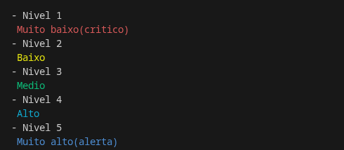
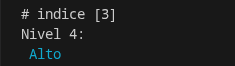

# Controle do Nível de Água



## Sobre

Esse programa foi desenvolvido com o objetivo de estudar sobre as bibliotecas em Python, e a biblioteca utilizada foi a colorama.

O código tem uma função que define as cores de cada nível usando match-case. Embaixo, é criada uma lista que armazena os níveis de 1 a 5 e uma variável ```choice``` que armazena o objeto daquele índice na lista. Então a função é chamada com a variável ```choice``` passada como parâmetro.



## Ferramentas Utilizadas

 Python

colorama

## Como testar

**É necessário ter o Python instalado no computador para executar.**

No VS Code

- abra a pasta do projeto

- clique no arquivo .py, depois clique em “Run” ou F5

- selecione “Run without debug”